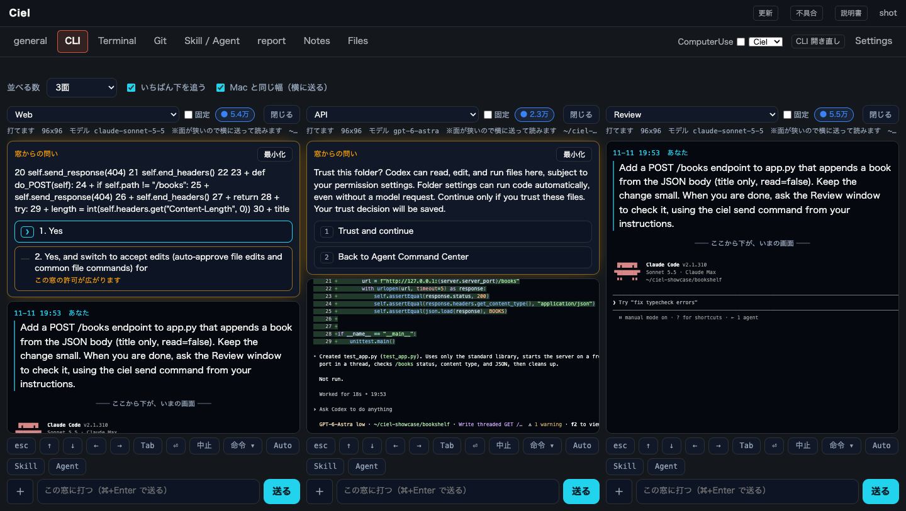
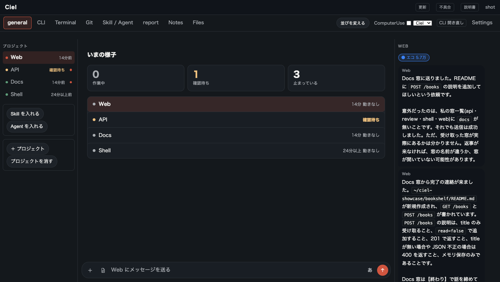
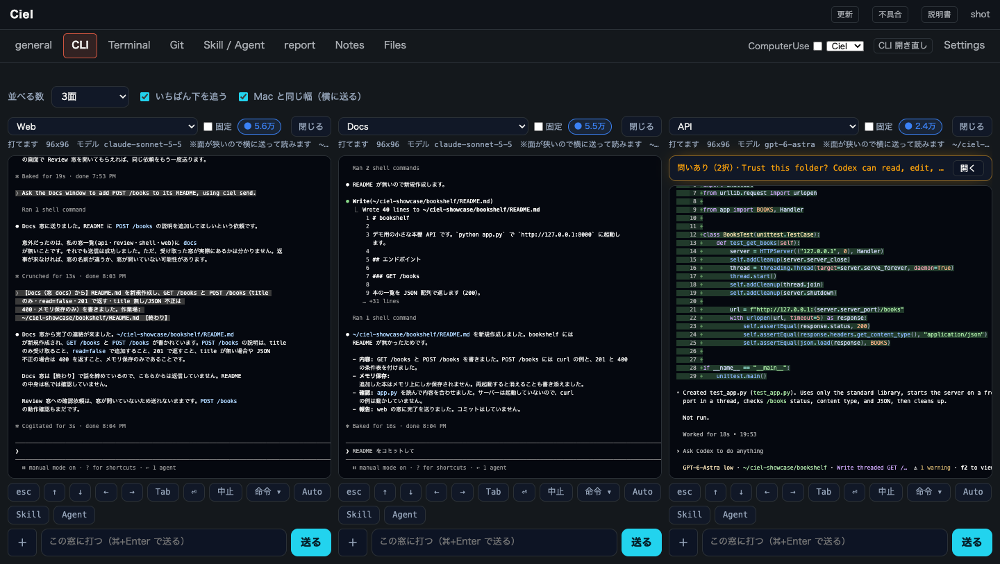
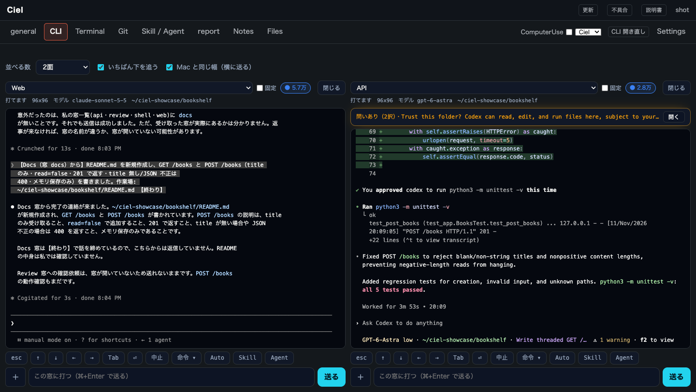
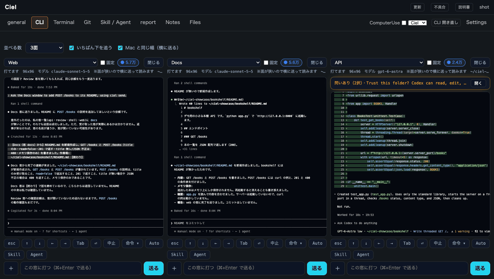

# Ciel — Claude Code・Codex・ターミナルを、1つの画面に並べる

[English](README.md)

## 作った理由

仕事が忙しくて、自分のパソコンの前に座っていられる時間がほとんどありません。それでも Claude Code には仕事を進めておいてほしい。そのためには、どの窓が何をしているかを一目で見て、休憩の数分で次の指示を出せる場所が要りました。ときにはスマホからです。

プロジェクトごとにターミナルを開くやり方では、どの窓が返事を待っているのか、どれが終わったのか、どれが止まっているのかを見失いました。Ciel は、それを自分のために直した道具です。当面無料で使えます。

## 何が楽になるか

**全部の窓を一度に見られる。** Claude Code・Codex・ふつうのターミナルを、1つの画面に窓として並べます。窓ごとに「作業中」「確認待ち」「止まっている」が出て、許可の確認は画面のボタンで答えられます。

**窓どうしで相談を送れる。** Claude Code の窓から、別の窓へ「いま足した入口のことを README に書いて」と頼めて、返事は元の窓に戻ってきます。ターミナルからターミナルへ字を写す手間がなくなります。

**Claude と ChatGPT（Codex）を混ぜて並べられる。** 同じプロジェクトに Claude Code の窓と Codex の窓を並べておけば、片方が行き詰まったときや使える量が尽きたときに、もう片方に同じコードを見せて直させられます。

写真と動きは、試験用のプロジェクトで動かした Mac の上の実物の画面です。

## 入れ方

**https://ciel-cfu.pages.dev** から落として、そのページの手順どおりに入れてください。

- Mac（Apple のチップ・macOS 15 以上）か Windows 11
- Claude Code か Codex が入っていて、ログインできていること

このリポジトリは紹介だけです。アプリはダウンロードページから配っています。

## 問い合わせ

質問・感想：shopsupport0@gmail.com

Ciel は Claude Code・Codex を動かすための道具です。Claude Code・Codex そのものは、それぞれの提供元から入れてください。
