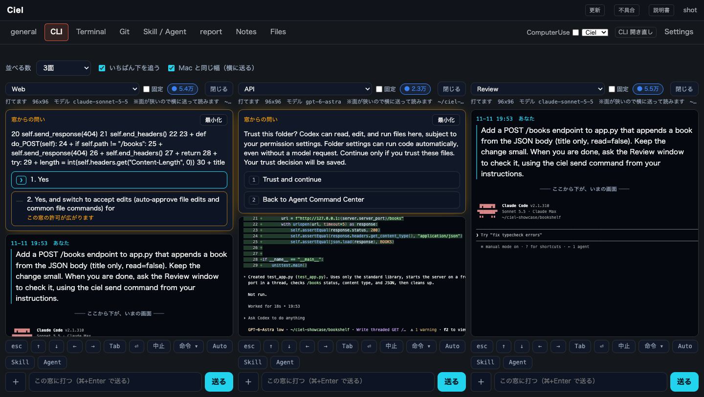
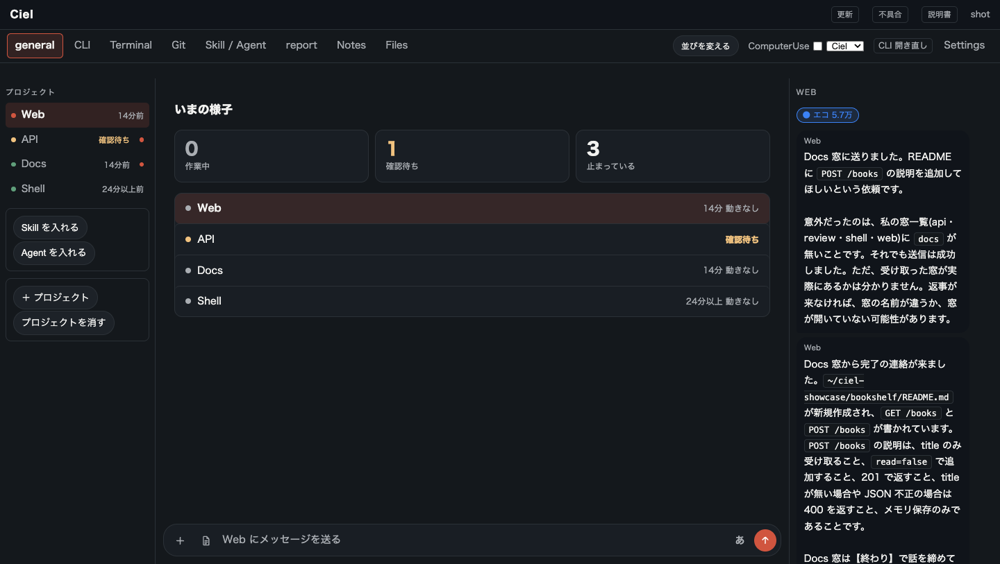
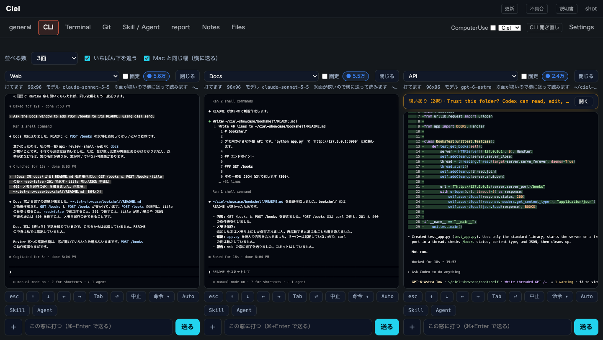
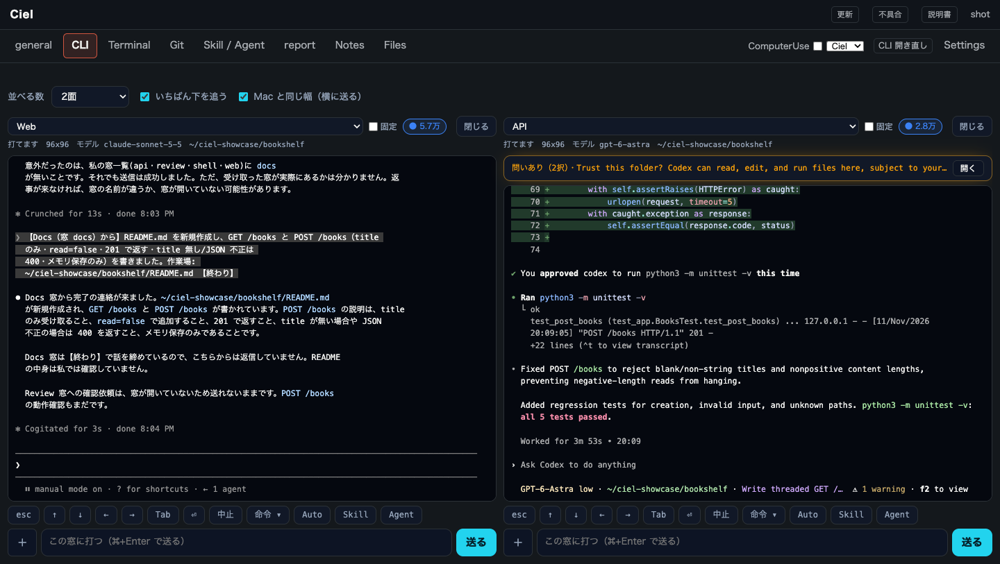
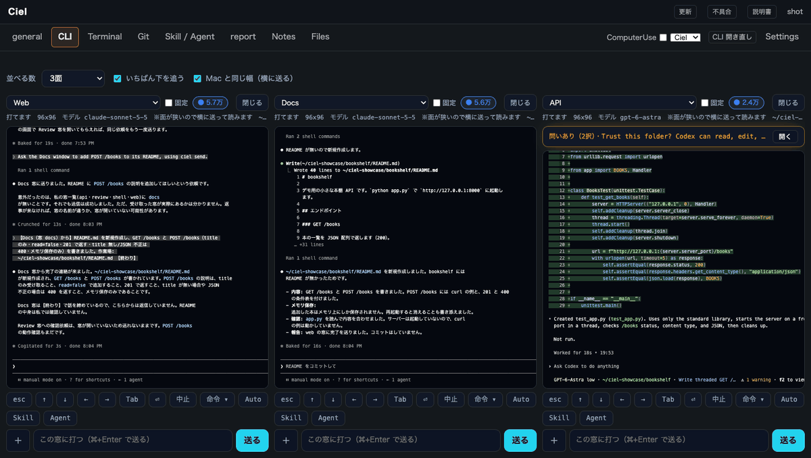

# Ciel — Claude Code, Codex and terminals side by side, on one screen

[日本語](README.ja.md)

## Why I built it

I work long hours and rarely get to sit in front of my own computer. I still wanted Claude Code to keep working on my projects, so I needed to see every session at a glance and send the next instruction in the few minutes I had, sometimes from my phone during a break.

Opening one terminal per project did not scale: I lost track of which session was waiting for an answer, which one had finished, and which one had stopped. Ciel is the tool I made for myself to fix that. It is free for now.

## What gets easier

**You see every session at once.** Claude Code, Codex and plain terminals run as windows on one screen. Each one says whether it is working, waiting for your answer, or stopped, and a permission question shows up as buttons you can press from the screen.

**Sessions can ask each other.** A Claude Code session can send a request to another window — "update the README for the endpoint I just added" — and the reply comes back to it. You do not have to copy text from one terminal into another.

**You can mix Claude and ChatGPT (Codex).** Put a Claude Code window and a Codex window next to each other on the same project. When one of them gets stuck, or runs out of its usage limit, ask the other one to look at the same code and fix it.

These are real screens of Ciel running on a Mac, recorded with test projects.

## Install

Download it from **https://ciel-cfu.pages.dev** and follow the steps on that page.

- Mac with Apple silicon, macOS 15 or later, or Windows 11
- Claude Code or Codex installed and signed in

This repository holds the introduction only. The app itself is distributed from the download page.

## Contact

Questions and feedback: shopsupport0@gmail.com

Ciel is a tool for running Claude Code and Codex. Install Claude Code and Codex themselves from their own providers.
